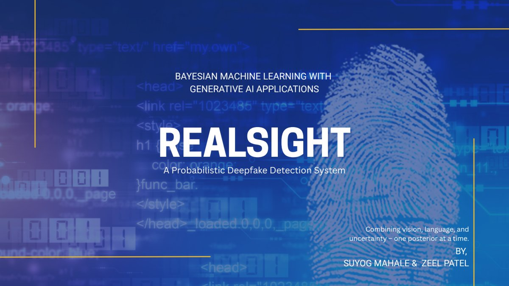
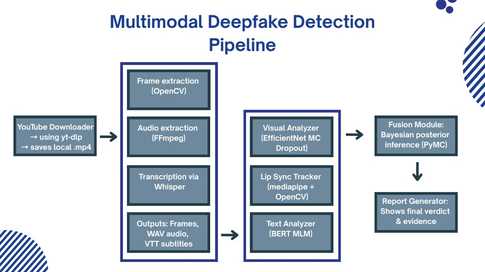

<picture>
  <source media="(prefers-color-scheme: dark)" srcset=".github/assets/banner-dark.png">
  
</picture>

# RealSight: Probabilistic Deepfake Detection

> **Example project from Spring 2025.** This repository holds the final presentation of RealSight by **Suyog Mahale** and **Zeel Patel**, [RealSight.pdf](RealSight.pdf). The authors have kept their code private to develop RealSight further on their own, so unlike the other example projects there is no code here to run. Course staff wrote this README from the slides and added the section on [what to learn from this project](#what-to-learn-from-this-project).

Given a YouTube video, how much evidence is there that it is a deepfake, and how sure should a viewer be? The team built a pipeline that takes a URL and returns a forensic report: it pulls the video, looks at the frames, listens to the audio, reads the transcript, and combines what each modality says into a probability of manipulation with a credible interval.

## Summary

RealSight is a system rather than a single model. A downloader fetches the video, its subtitles and its metadata with yt-dlp. OpenCV slices the video into frames at a configurable rate and FFmpeg extracts the audio. Whisper transcribes the audio with word-level timestamps. Three analyzers then score the material: a convolutional deepfake detector run with Monte Carlo dropout gives each frame a suspicion score and an uncertainty; MediaPipe's face mesh tracks the upper and lower lip in every frame, and the mouth openness during each spoken word becomes a lip-sync signal; and BERT, used as a masked language model, gives the transcript a perplexity, read as how natural the speech sounds. A fusion module combines the visual and transcript evidence in a PyMC model and reports the posterior mean probability of a fake with a 95 percent highest-density interval. A report generator writes every intermediate result to JSON and fills a notebook template, so the output for each video is a Jupyter report with the frame table, the lip-sync statistics, a transcript sentiment, the plausibility check and the posterior plot. The slides walk through the system on one video, a well-known Morgan Freeman deepfake, and end with the generated report, which concludes "moderate evidence of manipulation".

## Team

Team "Newton's Nemeses", Spring 2025.

- **Suyog Mahale**
- **Zeel Patel** ([@zeelpatel7](https://github.com/zeelpatel7))

The code is in a private repository, and the presentation doesn't divide the work between the two authors, so course staff attribute the project to both equally.

## The presentation

[RealSight.pdf](RealSight.pdf), 34 slides. The deck is organized around the pipeline diagram below, which returns before each stage.

| Slides | Contents |
|---|---|
| 1–2 | Motivation: the rise of deepfake media and the opacity of existing detection tools. |
| 3–12 | Download, frame and audio extraction, and Whisper transcription, each shown with the files it produces. |
| 13–16 | The visual analyzer: per-frame suspicion scores and uncertainties from Monte Carlo dropout. |
| 17–19 | Lip landmark extraction with MediaPipe and the per-word mouth-openness file. |
| 20–22 | The linguistic plausibility check with BERT. |
| 23–26 | Fusion: word-level desync flags, the weighted composite score, and the PyMC model, shown as code. |
| 27–32 | Packaging the outputs, the notebook report generator, and the generated report. |
| 33 | The repository layout, with a one-line description of each module. |

## Method, as presented

**Visual.** A pretrained convolutional deepfake detector scores each extracted frame; the pipeline diagram calls it EfficientNet and the repository layout calls it Xception. Dropout is left on at inference and each frame is scored repeatedly, so a frame gets a mean suspicion and a spread, which is the Monte Carlo dropout approximation to a Bayesian neural network. The frames with the highest scores go into the report.

**Lip sync.** MediaPipe face-mesh landmarks 13 and 14, the inner upper and lower lip, are tracked in every frame. Whisper's word timestamps map each word to its frames, and the average mouth openness during a word, with a flag when it falls below a threshold, is the lip-sync evidence.

**Language.** The transcript, stripped of timestamps, is scored with bert-base-uncased as a masked language model. Perplexity is turned into a plausibility score, with an interval around it described as "simulated using Bayesian sampling with PyMC".

**Fusion.** A weighted composite of visual suspicion, the inverse of mouth openness, and one minus the plausibility, with weights in a config file, gives the final score. Separately, the `bayesian_fusion` function on slide 26 builds a PyMC model with a Normal around the visual score and a Normal around the transcript score, both with scale 0.1, defines the probability of a fake as their average, samples it with NUTS, and reports the mean and the 95 percent interval.

### What is Bayesian here

Monte Carlo dropout is the Bayesian piece that works as described: repeated stochastic forward passes approximate samples from a posterior over the detector's weights, and the spread of the scores is predictive uncertainty, reported per frame. Reporting the final verdict as a probability with an interval, and plotting the posterior with a region of practical equivalence in the generated report, is the right instinct. The point of a Bayesian detector is to say how sure it is.

## What to learn from this project

Course staff added this section. It is written from the slides alone, since the code isn't public, so read it as questions to ask of the design rather than findings about the code.

- **A posterior needs observations.** The fusion model on slide 26 has two priors and no observed variable, so what the sampler draws is the prior. The average of two Normals with scale 0.1 has scale 0.07, and its 95 percent interval is the mean plus or minus 0.14 for every video, which is the width shown on slides 26 and 32. For the interval to say something about the video, the frame scores, the desync flags and the perplexity have to enter the model as data through a likelihood, with the probability of a fake as the quantity being inferred. The model as written also has a closed form, so it doesn't need a sampler.
- **Check that each signal discriminates.** The most suspicious frames on slides 16 and 31 score between 0.46 and 0.50, with the average at 0.48, so the frame detector is close to a coin flip on every frame of this video. A detector's output should be checked on known real and known fake clips before it is fused with anything.
- **Evaluate on labeled videos.** The deck shows one video, a known deepfake, and the system leans the right way on it. A set of real and fake clips, with the detection rate at a fixed false-alarm rate or the calibration of the reported probabilities, would tell a reader whether the pipeline works.
- **Say where the models come from.** The slides don't say which pretrained detector weights are used or which deepfake dataset trained them, and they name two architectures for the same component.

What the project does well: it is a complete system, from a URL to a readable report, with every stage producing an inspectable file; aligning lip motion to Whisper's word timestamps is a sound idea for a lip-sync signal; the three modalities are the right ones to combine for this problem; and the report puts an uncertainty next to its verdict instead of a bare label, which is what a probabilistic detector should do. It is also the one project in this collection whose authors are carrying it beyond the course.

## About this project

This project was built in Bayesian Machine Learning with Generative AI Applications (ADSP 32014), part of the Master of Science in Applied Data Science at the University of Chicago, in Spring 2025. It is shown here as an example for later cohorts, as a slide deck, because the code is private.

## What course staff added

The authors' presentation is unchanged. Course staff added this README with the program banner and the three preview images, rendered from the PDF.

## License

The presentation is the authors' work and is shown here with their names. Ask them before reusing it.
